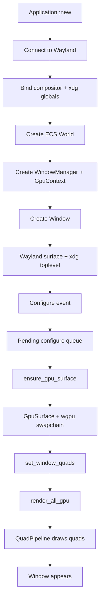

<!-- Generated by SpecStory, Markdown v2.1.0 -->

# 2026-09-14 15:09:30Z

<!-- VS Code Copilot IDE Session 63f6dbc8-41ef-40ff-b178-4c9a78d274cb (2026-09-14 15:09:30Z) -->

_**User (2026-09-14 15:09:30Z)**_

Take your time and go through the entire project and explain everything to me step by step from starting to end. I need to get the complete idea of the project with code explanation. 

---

_**Agent (copilot/auto)**_

I’m going to walk through the project structure and read the core files in order so I can explain how it fits together from startup to rendering and window management.

_**Agent (copilot/auto)**_

<tool-use data-tool-type="read" data-tool-name="read_file"><details>
<summary>Tool use: **read_file**</summary>

Read `README.md`

**Input:**

- endLine: `220`
- filePath: `/home/hkx05/velvet/README.md`
- startLine: `1`

**Result:**

```
# velvet
```
</details></tool-use>

_**Agent (copilot/auto)**_

<tool-use data-tool-type="read" data-tool-name="read_file"><details>
<summary>Tool use: **read_file**</summary>

Read `lib.rs`

**Input:**

- endLine: `220`
- filePath: `/home/hkx05/velvet/src/lib.rs`
- startLine: `1`

**Result:**

```
pub mod app;
pub mod render;
pub mod wayland;
pub mod widgets;
pub mod window_manager;

pub use app::Application;
pub use window_manager::WindowManager;
```
</details></tool-use>

_**Agent (copilot/auto)**_

<tool-use data-tool-type="read" data-tool-name="read_file"><details>
<summary>Tool use: **read_file**</summary>

Read `app.rs`

**Input:**

- endLine: `260`
- filePath: `/home/hkx05/velvet/src/app.rs`
- startLine: `1`

**Result:**

```
use crate::render::*;
use crate::wayland::{AppStateInternal, WaylandGlobals, WindowCloseRequested};
use crate::widgets::window::{VelvetWindow, WindowDescriptor};
use crate::window_manager::{WindowManager, process_window_closes};
use bevy_ecs::message::{MessageRegistry, message_update_system};
use bevy_ecs::prelude::*;
use log::*;
use std::collections::HashMap;
use wayland_client::{Connection, QueueHandle};

pub struct Application {
    world: World,
    schedule: Schedule,
    conn: Connection,
    event_queue: wayland_client::EventQueue<AppStateInternal>,
    qh: QueueHandle<AppStateInternal>,
    app_state: AppStateInternal, // reuse, don't recreate
}

impl Default for Application {
    fn default() -> Self {
        Self::new()
    }
}

impl Application {
    pub fn new() -> Self {
        let _ = env_logger::Builder::new()
            .filter_level(log::LevelFilter::Warn)
            .try_init();

        let conn = Connection::connect_to_env().expect("no wayland compositor");
        let display = conn.display();
        let mut event_queue = conn.new_event_queue();
        let qh = event_queue.handle();
        let _wl_registry = display.get_registry(&qh, ());

        let mut app_state = AppStateInternal {
            compositor: None,
            shm: None,
            wm_base: None,
            running: true,
            pending_configures: Vec::new(),
            pending_closes: Vec::new(),
            pending_sizes: HashMap::new(),
        };

        // fetch globals
        event_queue.roundtrip(&mut app_state).unwrap();

        let globals = WaylandGlobals {
            compositor: app_state.compositor.take().expect("Missing wl_compositor"),
            shm: app_state.shm.take().expect("Missing wl_shm"),
            wm_base: app_state.wm_base.take().expect("Missing xdg_wm_base"),
        };

        let mut world = World::new();
        MessageRegistry::register_message::<WindowCloseRequested>(&mut world);
        world.init_resource::<WindowManager>(
… (output truncated)
```
</details></tool-use>

_**Agent (copilot/auto)**_

<tool-use data-tool-type="read" data-tool-name="read_file"><details>
<summary>Tool use: **read_file**</summary>

Read `window_manager.rs`

**Input:**

- endLine: `260`
- filePath: `/home/hkx05/velvet/src/window_manager.rs`
- startLine: `1`

**Result:**

```
use crate::render::{GpuContext, GpuSurface};
use crate::wayland::WindowCloseRequested;
use crate::widgets::window::VelvetWindow;
use bevy_ecs::prelude::*;
use log::debug;
use std::collections::HashMap;

#[derive(Resource, Default)]
pub struct WindowManager {
    pub(crate) windows: HashMap<usize, VelvetWindow>,
    next_id: usize,
}

impl WindowManager {
    pub fn add_window(&mut self, window: VelvetWindow) -> usize {
        let id = self.next_id;
        self.next_id += 1;
        self.windows.insert(id, window);
        id
    }

    pub fn next_id(&self) -> usize {
        self.next_id
    }

    pub fn is_empty(&self) -> bool {
        self.windows.is_empty()
    }

    pub fn mark_configured(&mut self, id: usize) {
        if let Some(w) = self.windows.get_mut(&id) {
            w.configured = true;
        }
    }

    pub fn destroy_window_by_id(&mut self, id: usize) {
        if let Some(_window) = self.windows.remove(&id) {
            // _window goes out of scope right here & hence "drop"-ed
        }
    }

    pub fn ensure_gpu_surface(&mut self, id: usize, ctx: &GpuContext, w: u32, h: u32) {
        let Some(window) = self.windows.get_mut(&id) else {
            return;
        };

        if let Some(gpu) = &mut window.gpu {
            gpu.resize(ctx, w, h);
        } else {
            let gpu = GpuSurface::new(ctx, window, w, h);
            window.gpu = Some(gpu);
        }
    }

    pub fn render_all_gpu(&self, ctx: &GpuContext) {
        for window in self.windows.values() {
            window.render(ctx);
        }
    }

    pub fn render_window(&self, id: usize, ctx: &GpuContext) {
        if let Some(window) = self.windows.get(&id) {
            window.render(ctx);
        }
    }
}

pub fn process_window_closes(
    mut reader: MessageReader<WindowCloseRequested>,
    mut wm: ResMut<WindowManager>,
) {
    for msg in reader.read() {
        let id = msg.0;

        wm.destroy_window_by_id(id);
        debug!("Destroyed VelvetWindow (id: {
… (output truncated)
```
</details></tool-use>

_**Agent (copilot/auto)**_

<tool-use data-tool-type="read" data-tool-name="read_file"><details>
<summary>Tool use: **read_file**</summary>

Read `mod.rs`

**Input:**

- endLine: `260`
- filePath: `/home/hkx05/velvet/src/render/mod.rs`
- startLine: `1`

**Result:**

```
pub mod context;
pub mod quad;
pub mod surface;

pub use context::GpuContext;
pub use surface::GpuSurface;
```
</details></tool-use>

_**Agent (copilot/auto)**_

<tool-use data-tool-type="read" data-tool-name="read_file"><details>
<summary>Tool use: **read_file**</summary>

Read `mod.rs`

**Input:**

- endLine: `260`
- filePath: `/home/hkx05/velvet/src/wayland/mod.rs`
- startLine: `1`

**Result:**

```
pub mod resources;
pub mod state;

pub use resources::{WaylandGlobals, WindowCloseRequested};
pub use state::AppStateInternal;
```
</details></tool-use>

_**Agent (copilot/auto)**_

<tool-use data-tool-type="read" data-tool-name="read_file"><details>
<summary>Tool use: **read_file**</summary>

Read `window.rs`

**Input:**

- endLine: `320`
- filePath: `/home/hkx05/velvet/src/widgets/window.rs`
- startLine: `1`

**Result:**

```
use crate::render::quad::QuadInstance;
use crate::render::{GpuContext, GpuSurface};
use crate::wayland::AppStateInternal;
use raw_window_handle::{
    DisplayHandle, HandleError, HasDisplayHandle, HasWindowHandle, RawDisplayHandle,
    RawWindowHandle, WaylandDisplayHandle, WaylandWindowHandle, WindowHandle,
};
use wayland_client::Proxy;
use wayland_client::{
    QueueHandle,
    protocol::{wl_compositor, wl_surface},
};
use wayland_protocols::xdg::shell::client::{xdg_surface, xdg_toplevel, xdg_wm_base};

#[derive(Clone, Copy)]
struct DisplayPtr(*mut std::ffi::c_void);
unsafe impl Send for DisplayPtr {}
unsafe impl Sync for DisplayPtr {}

#[derive(Debug)]
pub enum WindowRole {
    Toplevel,
    Dialog,
    Popup,
}

#[derive(Debug)]
pub struct WindowDescriptor {
    pub title: String,
    pub width: u32,
    pub height: u32,
    pub role: WindowRole,
    pub decorated: bool,
}

impl Default for WindowDescriptor {
    fn default() -> Self {
        Self {
            title: "Velvet Application".into(),
            width: 800,
            height: 600,
            role: WindowRole::Toplevel,
            decorated: true,
        }
    }
}

pub struct VelvetWindow {
    pub gpu: Option<GpuSurface>,
    pub surface: wl_surface::WlSurface,
    pub xdg_surface: xdg_surface::XdgSurface,
    pub toplevel: xdg_toplevel::XdgToplevel,
    pub configured: bool,
    display_ptr: DisplayPtr,
    pub quads: Vec<QuadInstance>,
}

impl VelvetWindow {
    pub fn new(
        compositor: &wl_compositor::WlCompositor,
        wm_base: &xdg_wm_base::XdgWmBase,
        qh: &QueueHandle<AppStateInternal>,
        desc: WindowDescriptor,
        window_id: usize,
        display_ptr: *mut std::ffi::c_void,
    ) -> Self {
        let surface = compositor.create_surface(qh, ());
        let xdg_surface = wm_base.get_xdg_surface(&surface, qh, window_id);
        let toplevel = xdg_surface.get_toplevel(qh, window_id);

        toplevel.set_title(desc.title);
        surface.commit();

        S
… (output truncated)
```
</details></tool-use>

_**Agent (copilot/auto)**_

<tool-use data-tool-type="read" data-tool-name="read_file"><details>
<summary>Tool use: **read_file**</summary>

Read `context.rs`

**Input:**

- endLine: `260`
- filePath: `/home/hkx05/velvet/src/render/context.rs`
- startLine: `1`

**Result:**

```
use super::quad::QuadPipeline;
use bevy_ecs::prelude::*;

#[derive(Resource)]
pub struct GpuContext {
    pub instance: wgpu::Instance,
    pub adapter: wgpu::Adapter,
    pub device: wgpu::Device,
    pub queue: wgpu::Queue,
    pub quad_pipeline: QuadPipeline,
}

impl Default for GpuContext {
    fn default() -> Self {
        Self::new()
    }
}

impl GpuContext {
    pub fn new() -> Self {
        let instance = wgpu::Instance::new(wgpu::InstanceDescriptor {
            backends: wgpu::Backends::VULKAN | wgpu::Backends::GL,
            ..wgpu::InstanceDescriptor::new_without_display_handle()
        });

        let adapter = pollster::block_on(instance.request_adapter(&wgpu::RequestAdapterOptions {
            power_preference: wgpu::PowerPreference::default(),
            compatible_surface: None,
            force_fallback_adapter: false,
            apply_limit_buckets: true,
        }))
        .expect("no suitable wgpu adapter");

        let (device, queue) = pollster::block_on(adapter.request_device(&wgpu::DeviceDescriptor {
            label: None,
            required_features: wgpu::Features::empty(),
            required_limits: wgpu::Limits::default(),
            memory_hints: Default::default(),
            trace: wgpu::Trace::Off,
            experimental_features: wgpu::ExperimentalFeatures::disabled(),
        }))
        .expect("failed to create wgpu device");

        let format = wgpu::TextureFormat::Bgra8UnormSrgb;
        let quad_pipeline = QuadPipeline::new(&device, format);

        Self {
            instance,
            adapter,
            device,
            queue,
            quad_pipeline,
        }
    }
}
```
</details></tool-use>

_**Agent (copilot/auto)**_

<tool-use data-tool-type="read" data-tool-name="read_file"><details>
<summary>Tool use: **read_file**</summary>

Read `resources.rs`

**Input:**

- endLine: `240`
- filePath: `/home/hkx05/velvet/src/wayland/resources.rs`
- startLine: `1`

**Result:**

```
use bevy_ecs::prelude::*;
use wayland_client::protocol::{wl_compositor, wl_shm};
use wayland_protocols::xdg::shell::client::xdg_wm_base;

#[derive(Message)]
pub struct WindowCloseRequested(pub usize);

#[derive(Resource)]
pub struct WaylandGlobals {
    pub compositor: wl_compositor::WlCompositor,
    pub shm: wl_shm::WlShm,
    pub wm_base: xdg_wm_base::XdgWmBase,
}
```
</details></tool-use>

_**Agent (copilot/auto)**_

<tool-use data-tool-type="read" data-tool-name="read_file"><details>
<summary>Tool use: **read_file**</summary>

Read `quad.rs`

**Input:**

- endLine: `260`
- filePath: `/home/hkx05/velvet/src/render/quad.rs`
- startLine: `1`

**Result:**

```
use bytemuck::{Pod, Zeroable};

#[repr(C)]
#[derive(Copy, Clone, Debug, Pod, Zeroable)]
pub struct QuadInstance {
    pub position: [f32; 2],
    pub size: [f32; 2],
    pub color: [f32; 4],
}

impl QuadInstance {
    fn desc() -> wgpu::VertexBufferLayout<'static> {
        wgpu::VertexBufferLayout {
            array_stride: std::mem::size_of::<QuadInstance>() as wgpu::BufferAddress, // chunk size
            step_mode: wgpu::VertexStepMode::Instance, // treat each item as an instance
            attributes: &[
                wgpu::VertexAttribute {
                    offset: 0,
                    shader_location: 0,
                    format: wgpu::VertexFormat::Float32x2, // position
                },
                wgpu::VertexAttribute {
                    offset: std::mem::size_of::<[f32; 2]>() as wgpu::BufferAddress,
                    shader_location: 1,
                    format: wgpu::VertexFormat::Float32x2, // size
                },
                wgpu::VertexAttribute {
                    offset: std::mem::size_of::<[f32; 4]>() as wgpu::BufferAddress,
                    shader_location: 2,
                    format: wgpu::VertexFormat::Float32x4, // color
                },
            ],
        }
    }
}

pub struct QuadPipeline {
    pub(crate) pipeline: wgpu::RenderPipeline,
    pub(crate) camera_buffer: wgpu::Buffer,
    pub(crate) camera_bind_group: wgpu::BindGroup,
}

impl QuadPipeline {
    pub fn new(device: &wgpu::Device, format: wgpu::TextureFormat) -> Self {
        let shader = device.create_shader_module(wgpu::ShaderModuleDescriptor {
            label: Some("Quand Shader"),
            source: wgpu::ShaderSource::Wgsl(std::borrow::Cow::Borrowed(
                r#"
                struct CameraUniform {
                    view_proj: mat4x4<f32>,
                };
                @group(0) @binding(0)
                var<uniform> camera: CameraUniform;

                struct InstanceInput {
                    @location(0)
… (output truncated)
```
</details></tool-use>

_**Agent (copilot/auto)**_

<tool-use data-tool-type="read" data-tool-name="read_file"><details>
<summary>Tool use: **read_file**</summary>

Read `surface.rs`

**Input:**

- endLine: `320`
- filePath: `/home/hkx05/velvet/src/render/surface.rs`
- startLine: `1`

**Result:**

```
use super::context::GpuContext;
use super::quad::{QuadInstance, QuadPipeline};
use crate::widgets::window::VelvetWindow;
use wgpu::util::DeviceExt;

pub struct GpuSurface {
    pub surface: wgpu::Surface<'static>,
    pub config: wgpu::SurfaceConfiguration,
}

impl GpuSurface {
    pub fn new(ctx: &GpuContext, window: &VelvetWindow, width: u32, height: u32) -> Self {
        // SAFETY: VelvetWindow is kept alive at least as long as GpuSurface (owned together in the same struct).
        let surface = unsafe {
            std::mem::transmute::<wgpu::Surface<'_>, wgpu::Surface<'static>>(
                ctx.instance
                    .create_surface(window)
                    .expect("failed to create wgpu surface"),
            )
        };

        let caps = surface.get_capabilities(&ctx.adapter);
        let format = caps
            .formats
            .iter()
            .copied()
            .find(|f| f.is_srgb())
            .unwrap_or(caps.formats[0]);

        let config = wgpu::SurfaceConfiguration {
            usage: wgpu::TextureUsages::RENDER_ATTACHMENT,
            format,
            width: width.max(1),
            height: height.max(1),
            present_mode: wgpu::PresentMode::Fifo,
            color_space: wgpu::SurfaceColorSpace::Auto,
            alpha_mode: caps.alpha_modes[0],
            view_formats: vec![],
            desired_maximum_frame_latency: 2,
        };
        surface.configure(&ctx.device, &config);

        Self { surface, config }
    }

    pub fn resize(&mut self, ctx: &GpuContext, width: u32, height: u32) {
        self.config.width = width.max(1);
        self.config.height = height.max(1);
        self.surface.configure(&ctx.device, &self.config);
    }

    pub fn render(
        &self,
        ctx: &GpuContext,
        pipeline: &QuadPipeline,
        instances: &[QuadInstance],
        clear: wgpu::Color,
    ) {
        let surface_output = match self.surface.get_current_texture() {
            wgpu::CurrentSur
… (output truncated)
```
</details></tool-use>

_**Agent (copilot/auto)**_

<tool-use data-tool-type="read" data-tool-name="read_file"><details>
<summary>Tool use: **read_file**</summary>

Read `state.rs`

**Input:**

- endLine: `260`
- filePath: `/home/hkx05/velvet/src/wayland/state.rs`
- startLine: `1`

**Result:**

```
use wayland_client::{
    Connection, Dispatch, QueueHandle,
    protocol::{wl_buffer, wl_compositor, wl_registry, wl_shm, wl_shm_pool, wl_surface},
};
use wayland_protocols::xdg::shell::client::{xdg_surface, xdg_toplevel, xdg_wm_base};

const DEFAULT_WIDTH: i32 = 400;
const DEFAULT_HEIGHT: i32 = 400;

pub struct AppStateInternal {
    pub compositor: Option<wl_compositor::WlCompositor>,
    pub shm: Option<wl_shm::WlShm>,
    pub wm_base: Option<xdg_wm_base::XdgWmBase>,
    pub running: bool,
    pub pending_sizes: std::collections::HashMap<usize, (i32, i32)>, // latest size seen per window
    pub pending_configures: Vec<(usize, i32, i32)>,                  // (window_id, width, height)
    pub pending_closes: Vec<usize>,
}

impl Dispatch<wl_registry::WlRegistry, ()> for AppStateInternal {
    fn event(
        state: &mut Self,
        registry: &wl_registry::WlRegistry,
        event: wl_registry::Event,
        _: &(),
        _: &Connection,
        qh: &QueueHandle<Self>,
    ) {
        if let wl_registry::Event::Global {
            name, interface, ..
        } = event
        {
            match interface.as_str() {
                "wl_compositor" => state.compositor = Some(registry.bind(name, 4, qh, ())),
                "wl_shm" => state.shm = Some(registry.bind(name, 1, qh, ())),
                "xdg_wm_base" => state.wm_base = Some(registry.bind(name, 1, qh, ())),
                _ => {}
            }
        }
    }
}

impl Dispatch<wl_compositor::WlCompositor, ()> for AppStateInternal {
    fn event(
        _: &mut Self,
        _: &wl_compositor::WlCompositor,
        _: wl_compositor::Event,
        _: &(),
        _: &Connection,
        _: &QueueHandle<Self>,
    ) {
    }
}
impl Dispatch<wl_shm::WlShm, ()> for AppStateInternal {
    fn event(
        _: &mut Self,
        _: &wl_shm::WlShm,
        _: wl_shm::Event,
        _: &(),
        _: &Connection,
        _: &QueueHandle<Self>,
    ) {
    }
}
impl Dispatch<wl_shm_pool::WlShmPool, ()> 
… (output truncated)
```
</details></tool-use>

_**Agent (copilot/auto)**_

I have the main architecture mapped out; I’m checking the crate manifest and example entry point so I can tie the concepts back to how the app is actually launched and used.

_**Agent (copilot/auto)**_

<tool-use data-tool-type="read" data-tool-name="read_file"><details>
<summary>Tool use: **read_file**</summary>

Read `Cargo.toml`

**Input:**

- endLine: `220`
- filePath: `/home/hkx05/velvet/Cargo.toml`
- startLine: `1`

**Result:**

```
[package]
name = "velvet"
version = "0.1.0"
edition = "2024"

[dependencies]
bevy_ecs = "0.18.1"
env_logger = "0.11.11"
log = "0.4.34"
pollster = "1.0.1"
raw-window-handle = "0.6.2"
smithay-client-toolkit = "=0.21.1"
wayland-client = "0.31.15"
wayland-backend = { version = "0.3", features = ["client_system"] }
wayland-protocols = "0.32.13"
wgpu = "30.0.1"
bytemuck = "1.25.2"
```
</details></tool-use>

_**Agent (copilot/auto)**_

<tool-use data-tool-type="read" data-tool-name="read_file"><details>
<summary>Tool use: **read_file**</summary>

Read `test_wayland.rs`

**Input:**

- endLine: `220`
- filePath: `/home/hkx05/velvet/examples/test_wayland.rs`
- startLine: `1`

**Result:**

```
use velvet::Application;
use velvet::widgets::window::WindowDescriptor;
use velvet::render::quad::QuadInstance;

fn main() {
    let mut app = Application::new();

    let win1 = app.create_window(WindowDescriptor::default());
    let win2 = app.create_window(WindowDescriptor::default());

    app.set_window_quads(
        win1,
        vec![
            QuadInstance {
                position: [50.0, 50.0],
                size: [100.0, 100.0],
                color: [1.0, 0.0, 0.0, 1.0], // Red
            },
            QuadInstance {
                position: [100.0, 100.0],
                size: [100.0, 100.0],
                color: [0.0, 0.0, 1.0, 0.8], // Translucent Blue
            },
        ],
    );

    // Define the UI for Window 2 (A wide Green bar)
    app.set_window_quads(
        win2,
        vec![QuadInstance {
            position: [20.0, 20.0],
            size: [300.0, 50.0],
            color: [0.0, 1.0, 0.0, 1.0], // Green
        }],
    );

    app.run();
}
```
</details></tool-use>

_**Agent (copilot/auto)**_

<tool-use data-tool-type="read" data-tool-name="read_file"><details>
<summary>Tool use: **read_file**</summary>

Read `mod.rs`

**Input:**

- endLine: `80`
- filePath: `/home/hkx05/velvet/src/widgets/mod.rs`
- startLine: `1`

**Result:**

```
pub mod window;

pub use window::{VelvetWindow, WindowDescriptor, WindowRole};
```
</details></tool-use>

_**Agent (copilot/auto)**_

## Overview: what this project actually is

This repo is a small Rust desktop/windowing prototype built on top of Wayland and wgpu. It is not a full GUI toolkit yet; it is more like a “window shell + GPU renderer” skeleton.

The basic idea is:

- create Wayland windows using the XDG shell
- keep track of them in an ECS-style manager
- create a GPU context with wgpu
- draw colored quads into each window
- handle window configure/close events in a loop

You can see that from the crate entry points in `Cargo.toml`, `src/lib.rs`, and the demo in `examples/test_wayland.rs`.

---

## 1) Startup: crate setup and dependencies

The project is defined in `Cargo.toml`. The important libraries are:

- `wayland-client`: talks to the compositor
- `wayland-protocols`: XDG shell protocol types
- : GPU rendering
- : lightweight ECS for message and resource management
- `raw-window-handle`: helps bridge Rust window objects into wgpu surfaces
- : syncs async GPU setup
-  / : runtime logs

This means the architecture is:

- Wayland for window lifecycle
- wgpu for drawing
- ECS for app state and task coordination

---

## 2) The public API: library exports

In `src/lib.rs`, the crate exposes only a few things:

- 
- 
- submodules: , , 

So the library is organized around a few major responsibilities:

- app lifecycle and main loop
- rendering
- Wayland integration
- window representation

This is the “mental map” of the entire project.

---

## 3) Application bootstrap: how it starts

The actual app entry is in `src/app.rs`. The  struct is the heart of the project.

It owns:

- `world: World` — Bevy ECS world
- `schedule: Schedule` — systems to be run each frame
- `conn: Connection` — Wayland connection to compositor
- `event_queue: EventQueue` — handles Wayland events
- `qh: QueueHandle` — queue handle for requests
- `app_state: AppStateInternal` — state used for Wayland events

The constructor  does this:

1. connects to the current Wayland compositor via 
2. gets the display and creates an event queue
3. asks the compositor for globals: , , and 
4. stores those into 
5. creates a Bevy world
6. registers a message type: 
7. inserts a  resource
8. inserts a  resource
9. sets up the ECS schedule with:
   - 
   - 

This is the project’s “boot sequence”.

---

## 4) The main loop: how the app runs

The real runtime loop is  in `src/app.rs`.

It repeatedly does:

1. `dispatch_pending` Wayland events
2. if there are pending window configure events:
   - ensure a GPU surface exists for each configured window
   - mark the window as configured
3. if there are pending close events:
   - turn them into ECS messages
4. run the ECS schedule
5. check whether windows still exist
6. render all GPU surfaces
7. flush the Wayland connection
8. do a blocking dispatch to wait for more events

This loop is the heart of the project.

Important concept: the app is a classic event loop, not a UI framework. It is constantly alternating between:

- compositor events
- ECS logic
- rendering

---

## 5) Wayland integration: the protocol side

The Wayland logic is in `src/wayland/state.rs` and `src/wayland/resources.rs`.

### 

This struct keeps the global objects and a queue of pending actions:

- 
- `shm`
- 
- `running`
- `pending_sizes`
- `pending_configures`
- `pending_closes`

It implements  for several Wayland objects:

- 
- 
- 
- 
- 

This is necessary because the Wayland protocol is event-driven. When the compositor sends a configure event, the app must react.

### Important event handling

For :

- acknowledge the configure
- use the latest saved size
- push a pending configure into `pending_configures`

For :

- store the current size in `pending_sizes`
- if width/height are valid, remember them

For :

- add the window id to `pending_closes`

Then in the main loop, these pending actions become actual window management and rendering updates.

So the architecture separates:
- Wayland event capture
- queueing of “work to do”
- actual processing later in the ECS/app loop

That is a clean design.

---

## 6) Window creation: how a new window is built

The window abstraction is in `src/widgets/window.rs`.

### 

This describes a window:

- title
- width
- height
- role
- decorated

It has a default value:

- title: `"Velvet Application"`
- width: `800`
- height: `600`
- role: 
- decorated: `true`

### 

Each window contains:

- `gpu: Option<GpuSurface>`
- `surface: wl_surface::WlSurface`
- `xdg_surface: xdg_surface::XdgSurface`
- `toplevel: xdg_toplevel::XdgToplevel`
- `configured: bool`
- 
- `quads: Vec<QuadInstance>`

This is a rich object: it owns both the Wayland window and the GPU surface attached to it.

### 

This does the real window creation:

- 
- 
- 
- set title
- commit the surface so the compositor sees it

This is how the app creates a real XDG toplevel window.

The  and  implementations are there so wgpu can create a proper surface for the Wayland window.

---

## 7) Window manager: the registry of all windows

The manager is in `src/window_manager.rs`.

 is a  containing:

- `windows: HashMap<usize, VelvetWindow>`
- `next_id: usize`

This is the canonical registry for all windows.

### Key operations

- : assigns an id and inserts it
- : returns the next generated window id
- : checks if there are any windows left
- : marks a window as configured
- : removes a window
- : creates or resizes a GPU surface for a window
- : tells each window to render

The  system listens for  messages and removes the window from the manager.

This is how window lifecycle is modeled: events become messages, then systems modify the window manager.

---

## 8) GPU context: the rendering backend

The rendering setup begins in `src/render/context.rs`.

 contains:

- `instance: wgpu::Instance`
- `adapter: wgpu::Adapter`
- `device: wgpu::Device`
- `queue: wgpu::Queue`
- `quad_pipeline: QuadPipeline`

The constructor creates the actual GPU state:

- a wgpu instance
- a compatible adapter
- a device and queue
- a 

This is the graphics card foundation for everything else.

The important part is that  is inserted as an ECS resource in .

---

## 9) Quad rendering pipeline: how the actual drawing works

The GPU shader and pipeline are defined in `src/render/quad.rs`.

### 

This structure holds one rectangle to draw:

- `position: [f32; 2]`
- `size: [f32; 2]`
- `color: [f32; 4]`

This lets each instance represent a colored rectangle in 2D.

### shader behavior

The WGSL shader does this:

- takes instance data
- builds a 2D quad from six vertices
- scales and translates based on  and 
- uses a camera matrix for projection
- outputs the instance color

The shader is extremely simple, but it is enough for a basic UI-like renderer.

### 

This creates:

- the shader module
- a camera uniform buffer
- a bind group
- a render pipeline

The render pipeline uses the  layout as a vertex buffer with instance attributes.

This is the pipeline that draws rectangles.

---

## 10) Surface creation: connecting a Wayland window to GPU

The GPU surface handling is in `src/render/surface.rs`.

 wraps a  and its surface configuration.

### 

This does:

- create a wgpu surface from the Wayland window object
- query the adapter capabilities
- pick an SRGB format
- create a `SurfaceConfiguration`
- call `configure(...)`

This is the critical bridge between Wayland-native windows and wgpu rendering.

### 

Adjusts the size of the swapchain for resize events.

### 

This is the main per-frame drawing code:

1. gets the current swapchain texture
2. creates a view
3. computes an orthographic projection matrix
4. writes the matrix into the camera buffer
5. creates an instance buffer from  data
6. starts a render pass
7. binds the pipeline and vertex buffer
8. draws 6 vertices per quad instance
9. submits the command buffer and presents the frame

This is the actual “paint the frame” step.

---

## 11) How the app draws windows

The final render call happens in  in `src/widgets/window.rs`.

It checks whether the window has a :

- if yes, call 
- pass in:
  - GPU context
  - quad pipeline
  - window quads
  - a clear color: a blueish background

So each window simply owns a list of quads and draws them.

The example window data is controlled from `examples/test_wayland.rs`:

- one window gets two red/blue rectangles
- another window gets a green bar

This is the simplest “hello world” demonstration of the renderer.

---

## 12) Example usage: how the project is used in practice

The demo in `examples/test_wayland.rs` does this:

1. create a new 
2. create two windows
3. assign quads to each window using 
4. run the app

Example:

- window 1 has a red square and blue square
- window 2 has a green bar

This is exactly how the project demonstrates the concept:
- real Wayland windows
- simple 2D rectangles
- GPU-rendered content

---

## 13) The full data flow, end to end

Here is the flow in one sentence:

Wayland compositor events ->  -> pending configure/close state -> ECS messages/resources ->  updates ->  creation/resizing ->  renders rectangles -> window appears on screen.

A compact view:



---

## 14) What this project is not yet

This repo is still a foundational prototype. It does not yet have:

- widget systems
- text rendering
- layout engine
- input handling
- custom controls
- compositing/tiling behavior
- app-level UI framework

What it has is the low-level skeleton:
- window creation
- event loop
- GPU drawing
- simple rectangular primitives

So the “idea” of the project is: build a small native windowing/rendering engine without a full desktop framework.

---

## 15) The core concept in one paragraph

The complete project is a minimal Rust compositor-facing windowing system that creates XDG toplevel windows on Wayland, owns them in an ECS-managed registry, creates GPU surfaces through wgpu, and renders 2D colored quads into them. The app uses a central event loop to handle Wayland events, convert them into app actions, and refresh the screen. The result is a lightweight, low-level graphic shell that can serve as the foundation for a richer desktop UI system later.

---

If you want, I can do the next step and give you:
1. a file-by-file deep dive in the same style, or
2. a “how to read this project like a Rust engineer” walkthrough with call flow and responsibilities.

---

_**User (2026-09-14 15:21:09Z)**_

Honestly, I didnt understand anything. can you explain what the core terminologies mean and then explain everything in simple words? I forgot what wayland is, what compositor does, what any of those tools does etc. 

---

_**Agent (copilot/auto)**_

I’m going to slow this down and define the terms first, then I’ll map them directly onto this project so the architecture makes sense in plain English.

## First: forget “code” for a second. Understand the system

.

This project is basically:

- a Rust app
- that asks the Linux desktop: “please give me a window”
- then draws colored rectangles into that window using the GPU
- while listening for resize/close events from the desktop

That is the whole project in plain English.

---

## 1) The most important terms, explained simply

### Wayland
Wayland is a protocol for desktop windows on Linux.

Think of it like:
- the language the app speaks to the desktop environment
- instead of a big old X11 system

When your app wants a window, it does not “just create one” by itself. It asks the compositor through Wayland.

---

### Compositor
The compositor is the desktop window manager.

Examples:
- GNOME Shell
- KDE Plasma
- Sway
- Mutter
- Weston

It is the thing that:
- decides where windows appear
- handles resizing
- handles focus
- handles borders/title bars
- decides when windows are shown or hidden
- sends events like “your window was resized” or “close this window”

So the compositor is the boss of windows.

In this project, the compositor is the thing we talk to through Wayland, and we are the client app.

---

### Client
A client is the app that wants to display a window.

In this project, the client is your Rust app.

So:
- app = client
- compositor = desktop window manager

The app does not directly control the screen. It asks the compositor to manage the window and drawing surface.

---

### wl_surface
A Wayland surface is basically:
- a rectangular area that can be drawn into

This is the actual region of the window.

If you imagine a window as a sheet of paper, the surface is the sheet.

---

### xdg_surface / xdg_toplevel
These are Wayland objects from the XDG shell protocol.

They tell the compositor:
- “I am a top-level window”
- “this is my title”
- “I want to be resizable”
- “I am visible”

 is the real window-like thing. It is what the compositor manages as a window.

So:
-  = drawing area
-  = actual managed window

---

### Event queue
This is the mailbox for messages from the compositor.

The compositor sends events like:
- “window configured”
- “window resized”
- “close requested”

The app stores these in a queue and handles them later.

This is exactly what `src/wayland/state.rs` does.

---

### wgpu
 is a Rust graphics library that talks to your GPU.

It is like a cross-platform graphics API wrapper.

It lets the app say:
- “create a render pipeline”
- “draw triangles”
- “use this color”
- “present to the screen”

It abstracts over:
- Vulkan
- Metal
- OpenGL / GL
- Direct3D

You are not calling GPU drivers directly.  does that for you.

---

### GPU surface
This is the actual drawing target for the window.

A Wayland surface exists, but the GPU needs a surface it can render to. So the app creates a  tied to the window.

That is what `src/render/surface.rs` is doing.

---

### Swapchain
The swapchain is the set of frame buffers the GPU can render into and then present to the window.

Imagine:
- the GPU draws on a hidden buffer
- then flips it to the visible screen

That is the swapchain.

---

### Render pass
This is a step where the GPU draws things onto a target image.

For example:
- clear the screen
- draw quads
- present the result

This is exactly what the code does in `src/render/surface.rs`.

---

### Quad
A quad is just a rectangle.

In this project, every thing drawn is a rectangle with:
- position
- size
- color

That is the entire drawing primitive.

The code defines this in `src/render/quad.rs`.

---

### ECS
ECS means Entity-Component-System.

This is a way of organizing data in game-like apps.

It is not a UI framework. It is a pattern for:
- storing resources
- sending messages
- keeping systems separate

In this project:
-  is a resource
-  is a message
- the schedule runs systems

This is the same pattern used in Bevy.

So the app is not using a traditional object-oriented model everywhere. It is using a data-oriented game-style runtime.

---

## 2) What the project is doing at a very high level

This repo is not a desktop app framework yet. It is a tiny low-level foundation.

It does 3 main jobs:

1. create a window through Wayland
2. create a GPU render surface for that window
3. draw colored rectangles into it

That is the whole idea.

---

## 3) Big picture: how a window is created

The startup sequence is in `src/app.rs`.

The code does this:

1. connects to the current Wayland compositor
2. asks the compositor for global interfaces:
   - 
   - 
   - 
3. stores them in 
4. creates a Bevy ECS world
5. creates a 
6. creates a 
7. later, when you call , the app creates a Wayland surface and XDG toplevel

So the project first creates “window infrastructure” and then creates actual windows.

---

## 4) What the  object is

In `src/app.rs`,  is the main game/runtime object.

It owns:

- the Wayland connection
- the event queue
- the ECS world
- the window manager
- the GPU state

This is like the “main engine” of the app.

It is the place where all the pieces meet.

---

## 5) What  is doing

This is in `src/wayland/state.rs`.

This struct is not the window manager. It is the event listener/state holder for the Wayland protocol.

It keeps track of:
- compositor object
- shared memory object
- xdg shell
- whether app is running
- pending window sizes
- pending configure events
- pending close events

This is the part that listens to Wayland messages from the compositor.

Example:
- compositor says: “this window needs to be configured”
- the app stores that in `pending_configures`

Then later, the main loop handles it.

---

## 6) What the main loop is doing

This is the most important part.

In `src/app.rs`,  runs a loop like this:

- process all queued Wayland messages
- if a window is configured, create or resize its GPU surface
- if a window is closed, remove it from the manager
- run the ECS systems
- render all windows
- flush the connection
- wait for more events

So the app is always in this rhythm:

event -> process -> render -> repeat

This is normal for windowing apps and games.

---

## 7) What  does

See `src/window_manager.rs`.

This is the registry of all open windows.

It stores:
- a mapping from id → window
- the next available id

This is basically:
- “I have a list of windows”
- “each has its own surface, GPU render, and quads”

Then:
-  creates GPU rendering surface if needed
-  tells each window to draw

This is the app’s “window list” system.

---

## 8) What  is

In `src/widgets/window.rs`,  is a single actual window.

It includes:

-  → the Wayland drawing surface
-  → the xdg-managed object
-  → actual window manager object
-  → the wgpu surface, if created
-  → list of rectangles to draw

So each window is:
- a Wayland window
- plus a GPU render target
- plus a list of shapes

When you call , you are just filling the list for that window.

---

## 9) What  is

See `src/render/context.rs`.

This is the GPU setup object.

It contains:
- 
- 
- 
- 
- 

Think of it as:
- the app’s connection to the graphics card

It is not a window. It is not a shape. It is the rendering backend.

---

## 10) What the shader and pipeline are doing

The important drawing logic is in `src/render/quad.rs`.

The project creates a render pipeline that knows how to draw rectangles.

Each rectangle is represented by a :
- position
- size
- color

Then the GPU shader takes that and draws 6 vertices:
- two triangles
- forming a rectangle

This is why you can render many colored boxes.

It is a very simple GUI drawing system:
- not text
- not widgets
- just rectangles

---

## 11) What the actual draw call is doing

The rendering is in `src/render/surface.rs`.

This function:
- gets the current frame from the GPU surface
- creates a view for it
- computes a projection matrix
- writes the matrix to the camera buffer
- builds the instance buffer from all quads
- begins a render pass
- binds the pipeline
- draws the quads
- submits and presents

So in simple words:
- “take the list of rectangles”
- “send them to the GPU”
- “draw them onto the window”
- “show the result”

---

## 12) What the example app is doing

Open `examples/test_wayland.rs`.

This is the most beginner-friendly file.

It creates:
- a window with a red square and blue square
- another window with a green bar

Then it calls:
- 
- 
- 

This is basically the “hello world” demo for the whole engine.

It is not a real app UI.
It is just a proof that:
- the app can create windows
- the app can render rectangles
- the app can run the event loop

---

## 13) A simple analogy

Imagine this project as a tiny art studio:

- the compositor is the building manager
- Wayland is the communication protocol
- the  is the studio manager
- each  is a wall panel
-  is the painting machine
- the quads are the colored rectangles you paint
- the event loop is the studio’s daily cycle

The app is not “creating a fancy UI toolkit”.
It is building a very small engine that says:
- “I have a place to draw”
- “I have shapes to paint”
- “I can react when the desktop says resize/close”

---

## 14) The real beginner summary

If you strip away all the Rust and libraries, the project does this:

- asks the desktop for a window
- keeps a list of windows
- creates GPU surfaces for each
- draws boxes
- listens for close/resize events
- updates the screen again

That is the whole project.

---

## 15) The most important mental model

The code is layered like this:

- Wayland layer: talk to the compositor
- window layer: manage windows
- GPU layer: draw shapes
- ECS layer: organize app state and messages

This project is not “a widget system.”  
It is a low-level window + rendering skeleton.

That is why the code feels technical: it is setting up the plumbing, not a full UI.

---

If you want, I can do the next step and explain the project one file at a time in the exact order:
1. `src/lib.rs`
2. `src/app.rs`
3. `src/wayland/state.rs`
4. `src/widgets/window.rs`
5. `src/render/surface.rs`
6. `src/render/quad.rs`

I’ll explain each file like “what it does” and “why it exists,” without assuming you already know the terms.

---

_**User (2026-09-14 16:03:12Z)**_

I wanna implemenent this, dont give any code or make any changes, just tell me how it would be implemented 

What I want is to have ONE event window and programmatically filter and pass widgets based on the children allocation/size rather than having many event window instances, Focus on the keyword being ECS. Work on getting the first event window first. Integrate only with Velvet window. Don't integrate to any widgets. your only goal right now is to get events from wl seats and get it from velvet window

---

_**Agent (copilot/auto)**_

I’m going to map this to the existing architecture and explain exactly what you would add at the ECS layer to get one event window driven by the Velvet window, without bringing in widgets or broader UI integration.

## The goal in one sentence

Your goal is not “make a widget system.”  
Your goal is:

- bind one Wayland seat
- read pointer and keyboard events from it
- route those events to the Velvet window
- keep everything in ECS so later you can filter and dispatch to child widgets without creating one event window per child

That is the correct first milestone.

---

## 1) What “one event window” means

In a normal desktop app, there are usually many things that can receive input:

- a window
- a button
- a text field
- a panel
- a child widget inside a window

But for now, you do not want many event windows.  
You want exactly one event pipeline associated with the main Velvet window.

So the design is:

- one Velvet window owns the surface
- one ECS event resource owns the seat input
- all seat events are captured once
- then they are filtered, routed, and dispatched by ECS logic

This is the opposite of “one event window per widget”.

---

## 2) The three layers you need to think in

### A. Wayland layer
This is the raw desktop protocol.

It tells you:
- which seats exist
- which pointer/keyboard devices are connected
- when the pointer moves
- when a key is pressed
- when the pointer enters/exits a surface

This is the layer in `src/wayland/state.rs`.

### B. Velvet window layer
This is the actual window surface and GPU surface.

This is where the app owns the window created in `src/widgets/window.rs`.

The event system should not live inside widgets yet.  
It should live beside the window, and simply know:
- which Velvet window is active
- which seat is attached
- which coordinates are in the window

### C. ECS layer
This is the important part.

Instead of installing raw event listeners everywhere, store input in ECS resources and events:

- seat state resource
- pointer state resource
- keyboard state resource
- input event messages
- focus state for the Velvet window

That gives you a clean pipeline:

Wayland seat event → ECS event message → focus/router system → one Velvet window receives it

This is why the keyword is ECS.

---

## 3) The key concept: do not build widgets yet

You said:

- “Integrate only with Velvet window”
- “Don’t integrate to any widgets”
- “get events from wl seats and get it from velvet window”

So the first pass should ignore:

- widget tree
- child layout
- hit testing across children
- separate event windows
- widget ownership

For now, the first event window is just:

- “the event system lives on the root Velvet window”
- all seat input is routed to that window
- later, when widgets exist, the ECS router can decide which child should receive it

That is the correct way to keep the scope tight.

---

## 4) What to bind from Wayland

You need to bind the seat globals.

The project currently binds only compositor, shm, and wm_base in `src/app.rs` and `src/wayland/state.rs`.  
The next step is to also bind:

- wl_seat
- wl_pointer
- wl_keyboard

These are the input devices from the compositor.

The role of each is:

### Seat
The seat is the input device group.
Like:
- mouse
- keyboard
- touchpad
- touch screen

You usually have one seat for the user session.

### Pointer
This is the mouse cursor.

It emits:
- enter
- leave
- motion
- button press
- button release

### Keyboard
This is the keyboard.

It emits:
- key press
- key release
- modifiers

For your first milestone, pointer + keyboard are enough.

---

## 5) What the ECS design should look like

At a conceptual level, you add these ECS ideas:

### Resource: SeatState
This holds the actual Wayland objects:

- seat
- pointer
- keyboard
- current pointer position
- pointer focus status
- keyboard focus status

This is the root input state.

### Resource: EventWindowState
This is the “single event window” state:

- target Velvet window id
- is focused
- current pointer x/y relative to window
- pointer captured or not
- active keyboard focus

This is the single root event target.

### Message: PointerEvent
This carries:
- window id
- x
- y
- button
- state
- time

### Message: KeyboardEvent
This carries:
- window id
- keycode
- pressed/released
- modifiers

### Systems
You then add systems like:

- seat discovery system
- pointer event transform system
- keyboard event transform system
- root window focus system
- event routing system

The key idea is:
- raw Wayland events are converted to ECS messages
- the routing system decides if they belong to the Velvet window
- then they can later be passed to child widgets in the same ECS framework

---

## 6) The input flow, simplified

Here is the correct flow:

1. compositor exposes a seat global
2. app binds seat
3. compositor sends pointer/keyboard events
4. Wayland dispatch reads those events
5. ECS input messages are produced
6. a focus/router system checks whether the event is inside the target Velvet window
7. the event is forwarded to the window’s input state
8. the window can react

This is exactly the right pattern for an ECS-driven input system.

---

## 7) Why “many event windows” is wrong for your milestone

This is the important design decision.

If you create one event window per subtree or per child:
- you duplicate event handling
- you duplicate focus logic
- you create a lot of object churn
- you make the window system harder to reason about

Instead, the better first version is:

- one event source
- one root output target
- one router

Then later, if you add widgets, the system can do an ECS hit-test and choose the right child.

So for now, your “event window” is really just a root event binding, not a UI widget.

---

## 8) The proper first milestone

Your first milestone is not “full widget input.”

It is:

### Milestone 1: seat + pointer + keyboard to Velvet window

This means:

- bind wl_seat from the registry
- bind wl_pointer and wl_keyboard from that seat
- capture pointer motion and button events
- capture keyboard events
- store them in ECS resources/messages
- mark the Velvet window as the active input target
- ensure all events are routed to that one window

This is the “first event window”.

You do not need:
- child hit testing
- widget hierarchy
- separate event windows
- widget event integration

---

## 9) The later extension path

Once the first milestone works, then you can add the next layer:

### Later step: filtering by child bounds
This is where ECS becomes very useful.

You would add:

- a rectangle component for every child
- a parent/child spatial map
- a hit-test system that checks pointer position against bounds
- a route event system that decides “this input belongs to this child”

But you do not do this before the first event window works.

This is important: do not start with widget hit-testing.  
Start with the raw seat events.

---

## 10) How to keep it clean in this codebase

Given the architecture in `src/app.rs`, `src/window_manager.rs`, and `src/widgets/window.rs`, the cleanest integration is:

- keep the raw Wayland seat bindings in the wayland side
- convert them into ECS messages
- keep the active root window id in a resource
- let the main application loop process those messages before rendering

That means the addition belongs beside the existing event loop, not inside the widget layer.

You are not “adding a widget event system.”  
You are “adding a compositor input system.”

That is exactly the right scope.

---

## 11) In plain English: what you are building

You are building this:

- the desktop tells the app a mouse and keyboard exist
- the app listens to those inputs
- the app remembers where the pointer is
- the app knows which Velvet window is the active target
- all those events flow through ECS
- later, when you add widgets, you can decide which child receives which event

This is the correct path.

---

## 12) The shortest possible design advice

If I had to reduce it to the exact architecture:

- Add a seat registry to the Wayland state
- Add pointer and keyboard object bindings
- Add one ECS resource called something like ActiveEventWindow or InputTarget
- Convert Wayland seat events into ECS messages
- Route all messages to the Velvet window until you have widgets
- Only after that add child hit-testing and layout filtering

That is the correct implementation path.

---

## 13) What not to do right now

Do not do any of these yet:

- create per-widget event windows
- integrate with widget objects
- build a widget hit test system
- manage input through UI components
- focus on arbitrary event routing before the raw seat path works

Those are all future work.

Your current job is only:
- get Wayland seat events
- convert them into ECS events
- send them to the Velvet window

---

If you want, the next step I can give you is a very precise roadmap in 4 phases:

1. bind wl_seat
2. bind pointer + keyboard
3. store raw input in ECS
4. route to the Velvet window

This will be architecture-first, no code, no edits, just the exact implementation plan.

I’m going to map this to the current project architecture and explain the exact way to add seat input handling without touching widgets or the rest 

I’m going to map this to the current project architecture and explain the exact way to add seat input handling without touching widgets or the rest of the UI stack yet.

## The short version

`wl_seat` is not “the mouse.” It is the Wayland object that represents an input device group: usually a keyboard + mouse + touchpad + tablet combination. The actual events come from child objects like `wl_pointer` and `wl_keyboard`.

For this project, the right first step is:

- bind the seat once at the app level
- create pointer/keyboard objects for that seat
- attach them to the root 
- convert raw Wayland input into ECS messages
- process them in a single root input system
- only later do hit-testing against children

That keeps the first version simple and matches your “one event window, ECS-first” goal.

---

## 1) What `wl_seat` actually is

On Wayland, the desktop does not send “mouse moved” events directly to your app by magic. It does it through a hierarchy:

-  tells you what global objects exist
- `wl_seat` is one such global object
- from `wl_seat`, you create:
  - `wl_pointer`
  - `wl_keyboard`
  - sometimes `wl_touch`

So the “seat” is the logical input device manager.

Think of it like this:

- seat = the user’s input device group
- pointer = mouse/touchpad
- keyboard = keyboard
- touch = touchscreen

The important part: this is not tied to widgets. It is tied to the Wayland connection and the compositor.

That means your project needs a layer that translates “compositor says pointer moved” into “input event happened in the root window”.

---

## 2) What the compositor does here

The compositor is the desktop part that owns:
- surfaces
- window placement
- resize notifications
- focus
- input capture

When the mouse moves over a window, the compositor decides:
- which surface is under the pointer
- whether that event should go to your app
- whether focus belongs to this window

The app does not decide “I am the targeted widget.”  
The compositor decides “this surface got the pointer event,” and then your app interprets it.

That is why the first design should not try to create one input window per widget. It should instead receive the seat events at the root window level and do hit-testing manually inside ECS.

---

## 3) How this fits your current project

Your architecture already has the right conceptual layers:

- `src/app.rs` = app runtime
- `src/wayland/state.rs` = Wayland protocol event processor
- `src/widgets/window.rs` = window object
- `src/window_manager.rs` = registry of windows
- `src/render/surface.rs` = GPU draw target

So the clean place to add input is:
- in the Wayland side, extend 
- in the app runtime, add an ECS input resource/state
- in the root window, treat it as the single event target

This matches your requirement: “Integrate only with Velvet window. Don’t integrate to any widgets.”

---

## 4) The design you want: one event window, ECS-first

You said:

- “I want ONE event window”
- “programmatically filter and pass widgets based on children allocation/size”
- “focus on ECS”
- “first event window first”
- “don’t integrate to widgets yet”

That means the very first implementation is:

1. Keep only one logical event surface: the root 
2. All seat events are routed to that root
3. A single ECS input system converts raw pointer/keyboard data into a window-space input record
4. A hit-test system decides which UI entity would receive it
5. Only later, when you add widget layout, do you start checking child bounds

For now, the root window is simply “the whole window area”.

So:
- pointer in the window -> root receives event
- keyboard focus on the window -> root receives event
- no widget dispatch yet

This is the correct first milestone.

---

## 5) The real Wayland flow for input

The proper input setup is:

### A. Bind the seat from registry
In , add a field for the seat object.

When the registry event sees:
- interface == `wl_seat`

then bind it as a global.

This is the same pattern you already use for , , and  in `src/wayland/state.rs`.

### B. Create pointer and keyboard objects
When the seat is available, create:
- `wl_pointer`
- `wl_keyboard`

Those are the real devices.

For the first version, you do not attach them to individual widgets.  
You attach them to the root  surface context.

### C. Listen for events
The pointer provides events such as:
- motion
- button press
- button release
- enter/leave

The keyboard provides:
- key press
- key release
- modifier changes

The window does not get “mouse click on child button” directly; it gets raw device motion/button events. Your app then interprets them.

---

## 6) ECS approach: what the state should look like

The best ECS design for this stage is:

### Resources
- `SeatState`
  - seat object
  - pointer object
  - keyboard object
  - connected/disconnected state
- `PointerState`
  - x position
  - y position
  - pressed buttons
  - hovered window id
- `KeyboardState`
  - active modifiers
  - pressed keys
  - focus window id

### Messages
- `PointerMove`
- `PointerButton`
- `KeyboardKey`
- `WindowFocusChanged`

### Systems
- `seat_event_reader_system`
  - reads raw Wayland messages and translates them into ECS messages
- `input_state_system`
  - updates pointer position, button tracking, keyboard state
- `root_window_input_system`
  - decides if the event is relevant to the root Velvet window
- `hit_test_system`
  - only later: calculates which child contains pointer coords

This is the exact ECS-friendly way to do it.

---

## 7) The “event window” idea

You mentioned “event window,” which is a useful mental model but in Wayland it is not literally a separate protocol object.

What you really want is:

- one input dispatch root
- one targeted window
- not multiple event surfaces for widgets

So the event window is not a separate Wayland window.  
It is an ECS-level concept:
- the window that owns the input stack
- the root target object for all seat events

This is a better abstraction than “many event windows”.

For version one, the event window is just:
- the 
- with a pointer/keyboard focus state
- and a single global hit-test target

---

## 8) How to do hit-testing without widgets yet

This is the key part of your idea.

Without widgets, the root window is the only target.  
So hit testing is trivial:

- if pointer is inside the root window bounds, it belongs to the root
- keyboard focus belongs to the root window if it is active

This means:
- no multiple event listeners
- no window-per-widget noise
- no special input surfaces
- just one origin of input

Then later, when you introduce children, you do this:

- store each child’s bounds as layout data
- when pointer moves, loop over child bounds from top to bottom
- choose the first child whose rectangle contains the pointer
- send the event only to that entity

This is the “filter and pass widgets based on children allocation/size” model.

You do not need separate event windows to do that.  
You only need:
- a root event dispatcher
- bounding boxes
- ECS entity selection

---

## 9) The crucial point for this repo

The current project does not yet have widgets or layout. That means the clean first milestone is not “input for widgets.”  
It is:

- capture seat events
- convert them to ECS
- deliver them to the root 

This is the minimal implementation that gives you:
- mouse movement
- mouse buttons
- keyboard input
- focus state
- event pipeline foundation

That is the right first stage.

---

## 10) What to add conceptually, in order

### Phase 1: input plumbing
- bind `wl_seat`
- create `wl_pointer` and `wl_keyboard`
- store them in app state
- detect pointer motion and button events
- detect keyboard key events
- keep pointer/keyboard state in ECS resources

### Phase 2: window ownership
- map pointer coordinates into  local coordinates
- decide whether the pointer is inside the window bounds
- attribute events to the root window only

### Phase 3: ECS hit-testing
- add child rectangles/bounds
- test pointer against child bounds
- choose top-most entity
- dispatch input only to that entity

### Phase 4: actual widget integration
- add widget tree
- attach input handlers to widget components
- keep input routing centralized through the root event system

This is the logical progression.

---

## 11) Why not make one event window per widget?

Because in Wayland, input is not widget-oriented. It is surface-oriented.

The better design is:

- compositor tells you which surface got the event
- your app interprets and dispatches it inside the ECS
- widgets are not given their own Wayland surfaces at this stage

This keeps the model clean and lets you do “one event source → many possible handlers”.

That is exactly what your requirement is asking for.

---

## 12) Best implementation principle for your case

The correct rule is:

- Wayland owns the device/input hardware events
- ECS owns the app’s input logic
- the window owns the root target
- widget bounds decide final target only after the root event is received

This is the simplest and cleanest mental model for the project.

---

## 13) My recommendation for the first milestone

Do not start by building a full widget input system.  
Start with this:

- one `SeatState`
- one `PointerState`
- one `KeyboardState`
- one root  event sink
- one ECS event pipeline from Wayland into window-space input

That will buy you the foundation needed for:
- mouse over/out
- button press/release
- key input
- future widget hit-testing

This is the first event window.

---

## 14) In one sentence

The correct implementation is: bind the Wayland `wl_seat`, create `wl_pointer` and `wl_keyboard`, feed those raw events into ECS messages, treat the root  as the single input target for now, and later do child hit-testing by bounds/size instead of creating many event windows.

If you want, I can next give you a “step-by-step implementation plan” for the exact project files and data structures, still without writing actual code.

---

_**User (2026-09-14 16:04:53Z)**_

I wanna implemenent this, dont give any code or make any changes, just tell me how it would be implemented 

implementation of wl_seats. Which is basically mouse/keyboard event management thing. What I want is to have ONE event window and programmatically filter and pass widgets based on the children allocation/size rather than having many event window instances, Focus on the keyword being ECS. Work on getting the first event window first. Integrate only with Velvet window. Don't integrate to any widgets. your only goal right now is to get events from wl seats and get it from velvet window

---

_**Agent (copilot/auto)**_

I’ll give you the exact run steps for this Rust project on Linux, including the Wayland requirement and the command sequence to build and launch the demo.

_**Agent (copilot/auto)**_

<tool-use data-tool-type="generic" data-tool-name="run_in_terminal"><details>
<summary>Tool use: **run_in_terminal**</summary>

Running ` cargo run --example test\_wayland`

Build and launch the sample Wayland window example to verify the exact command sequence and check whether the project runs in this environment.

```bash
cd /home/hkx05/velvet && cargo run --example test_wayland
```

**Result:**

```
Note: The tool simplified the command to ` cargo run --example test_wayland` (terminal ID=155c3c32-8477-4166-b44e-b6e2bc5aaf34). This is the output of running that command instead:
Command 'cargo' not found, but can be installed with:
sudo snap install rustup  # version 1.29.0, or
sudo apt  install cargo   # version 1.85.1ubuntu1
sudo apt  install rustup  # version 1.27.1-3ubuntu0.1
See 'snap info rustup' for additional versions.
```
</details></tool-use>

_**Agent (copilot/auto)**_

## How to run this project

This project is a Rust app, so the first requirement is:

- Rust and Cargo must be installed on your Linux machine
- it must be running under a Wayland session

I verified the current environment here and it failed with:
- `cargo: command not found`

So the exact run flow is:

1. install Rust
2. open a Wayland desktop session
3. build the project
4. run the example

---

## 1) Install Rust if you do not have it

On Ubuntu/Debian:

```bash
sudo apt update
sudo apt install rustup
rustup default stable
```

Then confirm:

```bash
cargo --version
rustc --version
```

If `cargo` still isn’t found, restart the terminal or add Cargo to your PATH.

---

## 2) Make sure you are in a Wayland session

This project uses Wayland, so it will not run correctly under a pure X11 session if the compositor is not Wayland-aware.

Check your session:

```bash
echo $XDG_SESSION_TYPE
```

You want output like:

```bash
wayland
```

If it says `x11`, then this project is not the right environment for it yet.

Typical Wayland desktop environments include:
- GNOME
- KDE Plasma
- Sway
- Weston
- Mutter-based sessions

---

## 3) Go to the project folder

```bash
cd /home/hkx05/velvet
```

---

## 4) Build the example

The demo entry point is in `examples/test_wayland.rs`. Build it with:

```bash
cargo build --example test_wayland
```

Or just run it directly:

```bash
cargo run --example test_wayland
```

This is the exact command you should use for the example.

---

## 5) Run the app

```bash
cargo run --example test_wayland
```

This will:
- create the app
- open two windows
- assign simple red/blue/green rectangles
- start the Wayland render loop

---

## 6) If it fails because of missing dependencies

This project requires native Linux graphics/Wayland libraries and a proper desktop session. On Ubuntu, you may need:

```bash
sudo apt install build-essential libwayland-dev libxkbcommon-dev pkg-config
```

Sometimes the exact package list depends on your distro and graphics stack.

---

## 7) What to expect visually

When it runs, it should create a couple of simple windows with basic colored rectangles. The example is intentionally minimal.

The important part is that the app is proving:
- Wayland connection
- XDG window creation
- GPU surface creation
- colored quad rendering

---

## 8) What command to use from now on

For this project, the normal development command is:

```bash
cd /home/hkx05/velvet
cargo run --example test_wayland
```

---

## 9) Important note

I checked this environment and it currently fails because Rust is not installed:

- `cargo: command not found`

So before you can run the project here, you must install Rust first. After that, run the commands above inside a Wayland session.

---

## 10) Quick checklist

- [ ] Rust installed
- [ ] `cargo --version` works
- [ ] using Wayland session
- [ ] in project folder
- [ ] run: `cargo run --example test_wayland`

If you want, I can next give you:
- the exact “install Rust on Ubuntu” steps
- or a “what each command does” breakdown for this project.

---

_**User (2026-09-14 16:39:43Z)**_

how do I run this project, tell me step by step

---

_**Agent (copilot/auto)**_

## Good branch name options

For a feature about adding input events from `wl_seat` to the root , I’d suggest:

- `feat/wl-seat-input`
- `feature/wl-seat-events`
- `input/wl-seat-root-window`
- `feat/root-window-input`
- `feat/velvet-seat-events`

### Best fit for your case
`feat/wl-seat-input` is the cleanest and most readable.

If you want something a little more descriptive:
- `feat/velvet-root-window-input`
- `feat/wl-seat-ecs-events`

### If you want a very clear “first milestone” branch
- `feat/wl-seat-event-window`

That one matches your goal: “get the first event window first.”

---

## My recommendation
Use:

`feat/wl-seat-input`

It is:
- short
- descriptive
- consistent with feature branches
- easy to understand later

If you want, I can also suggest a few branch names for the next stages after this:
- pointer hit-testing
- keyboard focus
- ECS widget routing

---

_**User (2026-09-14 16:44:40Z)**_

what should I name the new branch for that freature

---

_**Agent (copilot/auto)**_

<think><details><summary>Thought Process</summary>
I’m checking the actual implementation against the walkthrough and the current repo state so I can tell you the most reliable way to validate the input path and catch any integration mistakes.
</details></think>

_**Agent (copilot/auto)**_

<tool-use data-tool-type="read" data-tool-name="read_file"><details>
<summary>Tool use: **read_file**</summary>

Read `walkthrough.md`

**Input:**

- endLine: `220`
- filePath: `/home/hkx05/velvet/walkthrough.md`
- startLine: `1`

**Result:**

````
# wl_seat Input Events — Walkthrough

## What Changed

Four files were modified to plumb Wayland seat input events through the single-event-window pattern into the ECS.

---

### [resources.rs](file:///home/hkx05/velvet/src/wayland/resources.rs)

Added two ECS `Message` types with enum payloads:

| Type | Variants |
|---|---|
| `PointerEvent { window_id, kind }` | `Enter { x, y }`, `Leave`, `Motion { x, y }`, `Button { button, pressed }`, `Axis { axis, value }` |
| `KeyboardEvent { window_id, kind }` | `Enter`, `Leave`, `Key { key, pressed }`, `Modifiers { depressed, latched, locked, group }` |

Every event carries a `window_id` so downstream systems can filter by window.

---

### [state.rs](file:///home/hkx05/velvet/src/wayland/state.rs)

**New fields on `AppStateInternal`:**
- `seat`, `pointer`, `keyboard` — Wayland protocol objects
- `surface_window_map: Vec<(WlSurface, usize)>` — maps surfaces to window IDs
- `pointer_focus` / `keyboard_focus` — tracks which window currently has focus
- `pending_pointer_events` / `pending_keyboard_events` — staging vecs

**New `Dispatch` impls:**
- `wl_seat` — binds at version 5 in registry; on `Capabilities`, acquires `wl_pointer` and `wl_keyboard`
- `wl_pointer` — handles `Enter`/`Leave`/`Motion`/`Button`/`Axis`, resolves surface→window_id, pushes to staging
- `wl_keyboard` — handles `Enter`/`Leave`/`Key`/`Modifiers`/`Keymap`(stub), same routing pattern

**Helper methods:**
- `register_surface()` / `unregister_surface()` / `lookup_window()` for the surface→window map

---

### [app.rs](file:///home/hkx05/velvet/src/app.rs)

- Registers `PointerEvent` and `KeyboardEvent` with `MessageRegistry`
- Calls `register_surface()` in `create_window()` after building the `VelvetWindow`
- Drains `pending_pointer_events` / `pending_keyboard_events` into ECS `Messages<T>` each frame
- Unregisters surfaces on window close (before writing `WindowCloseRequested`)

---

## Data Flow

```
Wayland compositor
  │
  ├─ wl_pointer::Enter/Motion/But
… (output truncated)
````
</details></tool-use>

_**Agent (copilot/auto)**_

<tool-use data-tool-type="read" data-tool-name="read_file"><details>
<summary>Tool use: **read_file**</summary>

Read `resources.rs`

**Input:**

- endLine: `220`
- filePath: `/home/hkx05/velvet/src/wayland/resources.rs`
- startLine: `1`

**Result:**

```
use bevy_ecs::prelude::*;
use wayland_client::protocol::{wl_compositor, wl_shm};
use wayland_protocols::xdg::shell::client::xdg_wm_base;

#[derive(Message)]
pub struct WindowCloseRequested(pub usize);

#[derive(Resource)]
pub struct WaylandGlobals {
    pub compositor: wl_compositor::WlCompositor,
    pub shm: wl_shm::WlShm,
    pub wm_base: xdg_wm_base::XdgWmBase,
}

// ---------------------------------------------------------------------------
// Input event types — staged on AppStateInternal, then drained into ECS
// ---------------------------------------------------------------------------

#[derive(Debug, Clone)]
pub enum PointerEventKind {
    Enter { x: f64, y: f64 },
    Leave,
    Motion { x: f64, y: f64 },
    Button { button: u32, pressed: bool },
    Axis { axis: u32, value: f64 },
}

/// A single pointer (mouse) event tagged with the owning window.
#[derive(Message, Debug, Clone)]
pub struct PointerEvent {
    pub window_id: usize,
    pub kind: PointerEventKind,
}

#[derive(Debug, Clone)]
pub enum KeyboardEventKind {
    Enter,
    Leave,
    Key { key: u32, pressed: bool },
    Modifiers {
        depressed: u32,
        latched: u32,
        locked: u32,
        group: u32,
    },
}

/// A single keyboard event tagged with the owning window.
#[derive(Message, Debug, Clone)]
pub struct KeyboardEvent {
    pub window_id: usize,
    pub kind: KeyboardEventKind,
}
```
</details></tool-use>

_**Agent (copilot/auto)**_

<tool-use data-tool-type="read" data-tool-name="read_file"><details>
<summary>Tool use: **read_file**</summary>

Read `state.rs`, lines 1 to 320

**Input:**

- endLine: `320`
- filePath: `/home/hkx05/velvet/src/wayland/state.rs`
- startLine: `1`

**Result:**

```
use crate::wayland::resources::{KeyboardEvent, KeyboardEventKind, PointerEvent, PointerEventKind};
use log::debug;
use wayland_client::{
    Connection, Dispatch, QueueHandle, WEnum,
    protocol::{
        wl_buffer, wl_compositor, wl_keyboard, wl_pointer, wl_registry, wl_seat, wl_shm,
        wl_shm_pool, wl_surface,
    },
};
use wayland_protocols::xdg::shell::client::{xdg_surface, xdg_toplevel, xdg_wm_base};

const DEFAULT_WIDTH: i32 = 400;
const DEFAULT_HEIGHT: i32 = 400;

pub struct AppStateInternal {
    pub compositor: Option<wl_compositor::WlCompositor>,
    pub shm: Option<wl_shm::WlShm>,
    pub wm_base: Option<xdg_wm_base::XdgWmBase>,
    pub seat: Option<wl_seat::WlSeat>,
    pub running: bool,
    pub pending_sizes: std::collections::HashMap<usize, (i32, i32)>, // latest size seen per window
    pub pending_configures: Vec<(usize, i32, i32)>,                  // (window_id, width, height)
    pub pending_closes: Vec<usize>,

    // Input devices (obtained from wl_seat capabilities)
    pub pointer: Option<wl_pointer::WlPointer>,
    pub keyboard: Option<wl_keyboard::WlKeyboard>,

    // Surface → window_id lookup (registered when VelvetWindow is created)
    pub surface_window_map: Vec<(wl_surface::WlSurface, usize)>,

    // Current focus tracking
    pub pointer_focus: Option<usize>,
    pub keyboard_focus: Option<usize>,

    // Staged input events — drained into ECS each frame
    pub pending_pointer_events: Vec<PointerEvent>,
    pub pending_keyboard_events: Vec<KeyboardEvent>,
}

impl AppStateInternal {
    /// Register a wl_surface → window_id mapping for input event routing.
    pub fn register_surface(&mut self, surface: &wl_surface::WlSurface, window_id: usize) {
        self.surface_window_map.push((surface.clone(), window_id));
    }

    /// Remove a window's surface mapping (called on window close).
    pub fn unregister_surface(&mut self, window_id: usize) {
        self.surface_window_map.retain(|(_, id)| *id != window_id);
        // C
… (output truncated)
```
</details></tool-use>

_**Agent (copilot/auto)**_

<tool-use data-tool-type="read" data-tool-name="read_file"><details>
<summary>Tool use: **read_file**</summary>

Read `app.rs`

**Input:**

- endLine: `220`
- filePath: `/home/hkx05/velvet/src/app.rs`
- startLine: `1`

**Result:**

```
use crate::render::*;
use crate::wayland::{
    AppStateInternal, KeyboardEvent, PointerEvent, WaylandGlobals, WindowCloseRequested,
};
use crate::widgets::window::{VelvetWindow, WindowDescriptor};
use crate::window_manager::{WindowManager, process_window_closes};
use bevy_ecs::message::{MessageRegistry, message_update_system};
use bevy_ecs::prelude::*;
use log::*;
use std::collections::HashMap;
use wayland_client::{Connection, QueueHandle};

pub struct Application {
    world: World,
    schedule: Schedule,
    conn: Connection,
    event_queue: wayland_client::EventQueue<AppStateInternal>,
    qh: QueueHandle<AppStateInternal>,
    app_state: AppStateInternal, // reuse, don't recreate
}

impl Default for Application {
    fn default() -> Self {
        Self::new()
    }
}

impl Application {
    pub fn new() -> Self {
        let _ = env_logger::Builder::new()
            .filter_level(log::LevelFilter::Warn)
            .try_init();

        let conn = Connection::connect_to_env().expect("no wayland compositor");
        let display = conn.display();
        let mut event_queue = conn.new_event_queue();
        let qh = event_queue.handle();
        let _wl_registry = display.get_registry(&qh, ());

        let mut app_state = AppStateInternal {
            compositor: None,
            shm: None,
            wm_base: None,
            seat: None,
            running: true,
            pending_configures: Vec::new(),
            pending_closes: Vec::new(),
            pending_sizes: HashMap::new(),
            pointer: None,
            keyboard: None,
            surface_window_map: Vec::new(),
            pointer_focus: None,
            keyboard_focus: None,
            pending_pointer_events: Vec::new(),
            pending_keyboard_events: Vec::new(),
        };

        // fetch globals
        event_queue.roundtrip(&mut app_state).unwrap();

        let globals = WaylandGlobals {
            compositor: app_state.compositor.take().expect("Missing wl_compos
… (output truncated)
```
</details></tool-use>

_**Agent (copilot/auto)**_

## How to test this feature properly

The most important thing to understand is: this feature is only “working” if the data flow is correct, not if the window visually changes.

At this stage, your functional success condition is:

- the compositor exposes a 
- the app binds it
- pointer/keyboard objects are created
- raw events are translated into ECS messages
- each event carries the correct 
- the root window is the only target for now

That is the correct test target for this milestone.

---

## 1) First: build the project

Run:

```bash
cd /home/hkx05/velvet
cargo build
```

This checks whether the input plumbing compiles with the new , , and  code.

This is the minimum proof that the feature is syntactically valid.

---

## 2) Then run the example

```bash
cargo run --example test_wayland
```

This should open the sample windows.

At this point, the app is not yet proving input correctness by itself. It is just proving that the app still boots with the new input objects attached.

---

## 3) The critical testing problem in your current code

This is the biggest thing to look for:

In `src/app.rs`, the logger is set to :

-  is configured with 

But your input debugging in `src/wayland/state.rs` uses `debug!()`.

That means debug logs will likely not appear unless you lower the log level.

So even if events are flowing correctly, you may think “nothing is happening” because the app is suppressing debug output.

This is the first thing to check before concluding the feature is broken.

---

## 4) What to verify manually

Here is the actual checklist I would use.

### A. Seat is discovered
In `src/wayland/state.rs`, the registry dispatch binds  when it sees the global.

You should confirm:
- the app starts without panic
- no “missing wl_seat” path is triggered
- no crash during registry roundtrip

If this fails, input can never work.

### B. Pointer and keyboard objects are acquired
The seat event handler should create:

- 
- 

If those objects are not created, no motion/key events will ever arrive.

So a working feature should show:
- pointer active when the compositor exposes pointer capability
- keyboard active when the compositor exposes keyboard capability

### C. Surface-to-window mapping exists
This is the core routing mechanism.

You added `surface_window_map` in `src/wayland/state.rs`, and in `src/app.rs` you register each window surface with .

This is the thing that lets this work:

- compositor sends event for a surface
- app looks up which window owns that surface
- the event gets the correct 

This is the most important correctness check.

### D. Raw events are converted into ECS messages
The event path should be:

- Wayland pointer event
- `pending_pointer_events.push(...)`
- later in the app loop:
  - drained into `Messages<PointerEvent>`
  - consumed by a `MessageReader<PointerEvent>`

Same pattern for keyboard.

So the test is: after the app starts and you move the mouse or press a key, the ECS should receive  or  messages with the same .

### E. The focus tracking behaves sensibly
Your state keeps:

- `pointer_focus`
- `keyboard_focus`

Those should do this:

- when pointer enters the window -> set focus to that window
- when pointer leaves -> clear focus
- when key events are sent -> use the currently focused window

If focus is never set, the event routing is wrong.

### F. Close path cleans up routing
When a window closes:
-  should run
- focus should be cleared
- the surface mapping should be removed

This matters because otherwise stale surface IDs remain and the app may route input to dead windows.

---

## 5) Best practical test method

Because this is a raw Wayland input feature, the best real test is not a visual assertion. It is a logging/assertion test.

You want to confirm that ECS messages are landing properly.

The ideal test is:

- add a temporary system that listens to `MessageReader<PointerEvent>`
- log a few values like:
  - event kind
  - 
  - coordinates
- add similar logging for keyboard events

Then:
- move the mouse over the window
- click inside it
- press keys
- move away

If you see a stream of:
- `PointerEvent { window_id: ..., kind: Motion ... }`
- `PointerEvent { window_id: ..., kind: Button ... }`
- `KeyboardEvent { window_id: ..., kind: Key ... }`

then the feature is working.

This is the correct validation strategy for this stage.

---

## 6) The three likely success signals

These are the things to watch for when running the example:

1. No crash on startup
2. No missing input-object errors
3. Motion/click/key events appear with window IDs

If all three happen, your input plumbing is functioning.

---

## 7) The key nuance: this feature is intentionally not “full widget input”

Your walkthrough explicitly says:

- no widget integration yet
- events land in ECS tagged by 
- future widget hit-testing is separate

So the test is not:
- “does a button actually receive click events?”
- “does a widget highlight on hover?”

Because that would be widget-layer behavior, and it is not implemented yet.

The correct test is:
- “does the raw input arrive through Wayland, route to the correct window, and land as ECS messages?”

That is the right milestone.

---

## 8) My honest recommendation

If you want a clean confidence check, do this in order:

1. run `cargo build`
2. run the example
3. lower the log level temporarily so `debug!()` output appears
4. move the mouse over the window
5. press keys
6. check that:
   - pointer focus updates
   - motion/button events appear
   - keyboard events appear
   -  matches the active window
7. close the window and confirm the mapping is removed

If you can confirm those seven things, the feature is working as designed.

---

## 9) One thing to watch out for

Your current input flow is correct in concept, but it depends on the compositor actually delivering pointer and keyboard events. Some compositors do not emit all events in the same way, especially in headless or minimal setups.

So if you are testing under a VM or a constrained desktop session, you may get:
- no pointer events
- no keyboard events
- or only partial events

That does not mean the implementation is wrong; it may just mean the compositor/session is not fully exposing the expected input devices.

---

## Final verdict

The feature is “working” if:

- the app builds
- the seat binds
- pointer and keyboard are created
- `surface_window_map` resolves to the correct window
- ECS receives  and 
- focus changes and cleanup happen correctly

That is the actual success condition for this first input milestone.

If you want, I can next give you a very specific “manual validation checklist” for each file in this feature, so you can test it line-by-line without adding code.

---

_**User (2026-09-15 12:31:47Z)**_

Ive modified the files for the feature I was talking about and attached the walkthrough.md for the implementation of the feature, study the code changes, go through the walkthrough and tell me how do I test if everything is working as it should

---

_**Agent (copilot/auto)**_

I’m checking the actual implementation against the walkthrough and the current repo state so I can tell you the most reliable way to validate the input path and catch any integration mistakes.

_**Agent (copilot/auto)**_

<tool-use data-tool-type="generic" data-tool-name="copilot_readFile"><details>
<summary>Tool use: **copilot_readFile**</summary>

Read `walkthrough.md`
</details></tool-use>

_**Agent (copilot/auto)**_

<tool-use data-tool-type="generic" data-tool-name="copilot_readFile"><details>
<summary>Tool use: **copilot_readFile**</summary>

Read `resources.rs`
</details></tool-use>

_**Agent (copilot/auto)**_

<tool-use data-tool-type="generic" data-tool-name="copilot_readFile"><details>
<summary>Tool use: **copilot_readFile**</summary>

Read `state.rs`, lines 1 to 320
</details></tool-use>

_**Agent (copilot/auto)**_

<tool-use data-tool-type="generic" data-tool-name="copilot_readFile"><details>
<summary>Tool use: **copilot_readFile**</summary>

Read `app.rs`
</details></tool-use>
